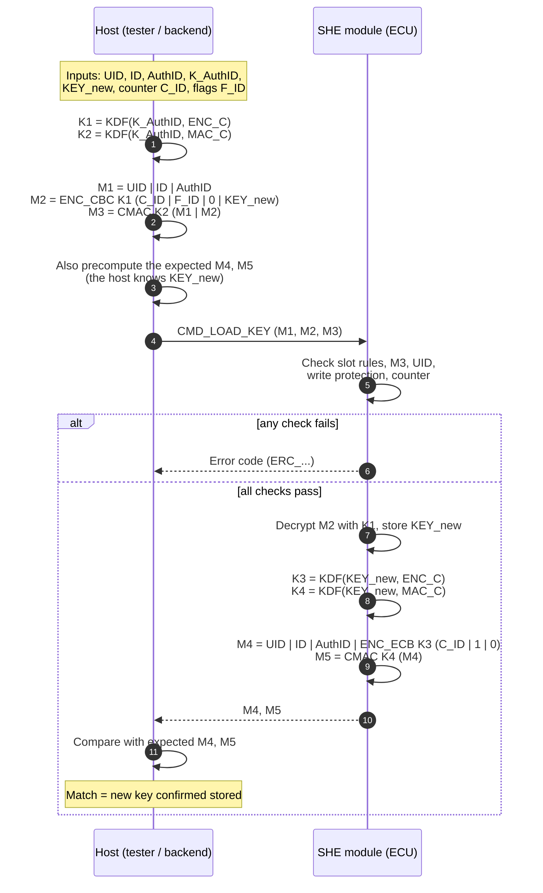
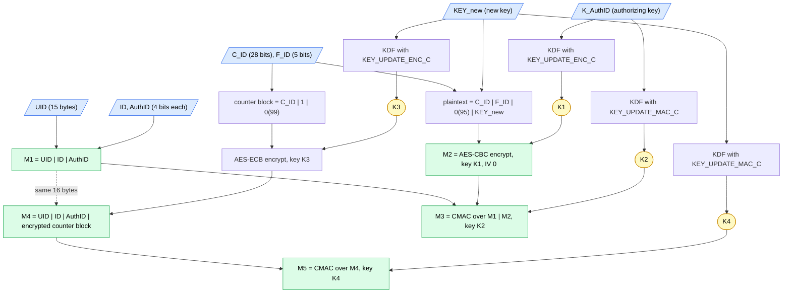
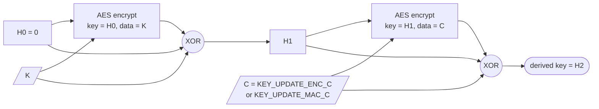
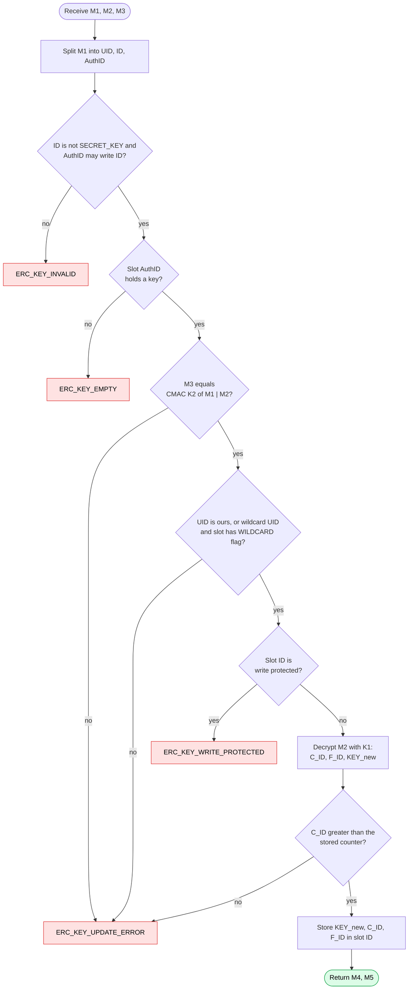

# SHE Memory Update Protocol (M1–M5)

[](https://github.com/NaveenSEC/SHE/actions/workflows/ci.yml)

An implementation of the AUTOSAR/HIS **Secure Hardware Extension (SHE)** key update
protocol (`CMD_LOAD_KEY`), with a software SHE emulator to test against. It comes in two
versions with the same behaviour and the same test cases:

- **Python** (`src/`, `tests/`): for host tools and quick experiments.
- **C99** (`c/`): no dependencies, also compiles as C++, suitable for ECU firmware or a
  native host tool. See [`c/README.md`](c/README.md).

1. The **host** builds the request M1, M2, M3 and the response it expects (M4, M5).
2. The **SHE emulator** checks the request the way a real SHE module does and replies with M4, M5.
3. The host **verifies** M4, M5 to confirm the key was actually stored.

Underneath it implements the SHE crypto: AES-128 ECB/CBC, AES-CMAC and the Miyaguchi-Preneel
key derivation function with the `KEY_UPDATE_ENC_C` / `KEY_UPDATE_MAC_C` constants.

## Message format

**[docs/PROTOCOL.md](docs/PROTOCOL.md) explains step by step how each of M1–M5 is formed**,
with the formula, the bit layout and the real intermediate values (K1–K4, plaintext blocks)
for the SHE specification example. Run the CLI with `--explain` to print the same
intermediate values for your own inputs.

```
M1 = UID(120) | ID(4) | AuthID(4)
M2 = ENC_CBC,K1,IV=0( C_ID(28) | F_ID(5) | 0(95) | KEY_new(128) )
M3 = CMAC,K2( M1 | M2 )
M4 = UID(120) | ID(4) | AuthID(4) | ENC_ECB,K3( C_ID(28) | 1 | 0(99) )
M5 = CMAC,K4( M4 )

K1 = KDF(K_AuthID, KEY_UPDATE_ENC_C)    K2 = KDF(K_AuthID, KEY_UPDATE_MAC_C)
K3 = KDF(KEY_new,  KEY_UPDATE_ENC_C)    K4 = KDF(KEY_new,  KEY_UPDATE_MAC_C)
KDF(K, C) = Miyaguchi-Preneel(K | C)
```

## How it works: flow diagrams

### 1. The whole exchange

The host proves it knows an existing (authorizing) key, sends the new key encrypted, and the
SHE module answers with a proof that only a module which really stored the new key can make.



### 2. How each message is computed

Blue = inputs, yellow = derived keys, green = messages. M1–M3 depend on the **old**
(authorizing) key; M4–M5 depend on the **new** key.



### 3. The key derivation function (KDF)

Every one of K1–K4 is made the same way, from a 16-byte key K and a 16-byte constant C,
using the Miyaguchi-Preneel construction with AES:



`H1 = E_H0(K) ⊕ K ⊕ H0` and `KDF(K, C) = H2 = E_H1(C) ⊕ C ⊕ H1`.

### 4. What the SHE module checks



(RAM_KEY skips the counter check: it has no counter and no flags.)

## Quick start (VS Code)

1. Open the folder in VS Code and install the recommended extensions when prompted.
2. `Terminal → Run Task → Create venv and install` (or run it manually):

   ```bash
   python3 -m venv .venv
   source .venv/bin/activate        # Windows: .venv\Scripts\activate
   pip install -e ".[dev]"
   ```
3. Select the `.venv` interpreter, then run the tests from the **Testing** view, or
   **Run and Debug → "SHE: run spec example (emulated)"**.

### Where is the Testing view?

It is the **flask/beaker icon** in the Activity Bar (the vertical strip of icons on the far
left of VS Code). You can also open it with **View → Testing**, or `Ctrl+Shift+P` (`Cmd+Shift+P`
on macOS) → *Testing: Focus on Test Explorer View*. If the icon is missing, right-click the
Activity Bar and tick **Testing**.

The Python tests appear there once the Python extension and the `.venv` interpreter are set up.
The C tests appear there once the CMake Tools extension has configured the `c/` project
(it asks on first open; choose a GCC/Clang/MSVC kit).

## Command line

```bash
she-update                     # spec example, run through the emulator
python -m she_memory_update    # same, without installing the script
```

Output for the SHE specification example (UID `00…01`, KEY_1 updated by MASTER_ECU_KEY
`000102…0f`, new key `0f0e…00`, counter 1):

```
M1 00000000000000000000000000000141
M2 2b111e2d93f486566bcbba1d7f7a9797c94643b050fc5d4d7de14cff682203c3
M3 b9d745e5ace7d41860bc63c2b9f5bb46
M4 00000000000000000000000000000141b472e8d8727d70d57295e74849a27917
M5 820d8d95dc11b4668878160cb2a4e23e
```

Options: `--uid`, `--key-id` (e.g. `KEY_3` or `0x6`), `--auth-id`, `--auth-key`, `--new-key`,
`--counter`, the flags `--write-protection --boot-protection --debugger-protection --key-usage
--wildcard`, `--no-emulate`, and `--explain` (prints K1–K4 and the plaintext of each message).

### Testing a real ECU

Run with `--no-emulate` and your chip's UID and keys. It prints M1–M3 to send to the MCU
(S32K, MPC57xx, RH850 and similar) and the M4/M5 to compare against what the chip returns.

> This code uses the 5-bit **SHE 1.1** flag field. SHE+ variants with a 6-bit field (adding
> `VERIFY_ONLY`) need a small change to `KeyFlags` and `build_m2` in `protocol.py`.

## Library use

```python
from she_memory_update import KeySlot, SheEmulator, build_key_update, verify_response

msgs = build_key_update(uid, KeySlot.KEY_1, KeySlot.MASTER_ECU_KEY, master_key, new_key, counter=1)
m4, m5 = ecu.load_key(msgs.m1, msgs.m2, msgs.m3)   # your transport, or SheEmulator
assert verify_response(msgs, m4, m5)
```

## Tests

```bash
pytest
```

- **Spec example:** all five messages match the SHE specification byte-for-byte.
- **Crypto:** NIST SP 800-38A AES ECB/CBC, RFC 4493 CMAC, and the spec's Miyaguchi-Preneel and KDF vectors.
- **Rejected requests:** tampered M2 or M3, wrong authorizing key, replay, non-increasing counter,
  UID mismatch, wildcard UID without the wildcard flag, write protection, unauthorized AuthID,
  loading SECRET_KEY, and an empty authorizing slot.
- **Valid updates:** loading RAM_KEY, rotating MASTER_ECU_KEY, a key authorizing itself, BOOT_MAC.

GitHub Actions runs the Python suite on Python 3.10–3.12, and the C suite on Linux, Windows
and macOS plus an AddressSanitizer/UBSan build, on every push.

## Project layout

```
docs/PROTOCOL.md  how M1..M5 are formed, step by step
c/              C99 implementation (library, she-update CLI, tests) - see c/README.md
src/she_memory_update/
  crypto.py     AES-128 ECB/CBC, CMAC, Miyaguchi-Preneel, KDF
  protocol.py   M1..M5 builders/decoders, KeySlot, KeyFlags
  emulator.py   SHE module emulator (CMD_LOAD_KEY checks)
  cli.py        she-update command
tests/          pytest suite
.vscode/        settings, launch configs, tasks
```

## License

MIT
